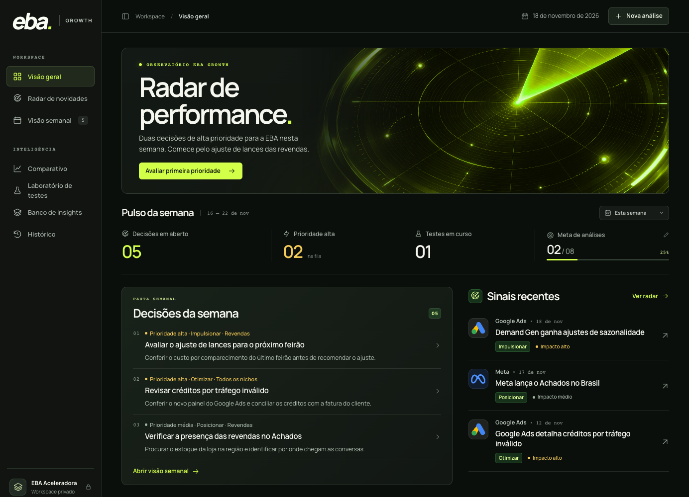

# Identidade visual da evolução

A direção aprovada combina composição editorial escura, imagem de radar, hierarquia tipográfica e cores da EBA. A prévia abaixo documenta o visual proposto para a evolução e para o CRM.

| Cor | Aplicação |
| --- | --- |
| Verde profundo `#0A0F0C` | Fundo da navegação e das áreas de trabalho. |
| Verde-limão `#D2FF48` | Ação principal da seção, foco e luz do radar. |
| Amarelo proposto `#F4CA58` | Pendências e prioridades, sempre acompanhadas de motivo escrito. |

Usar tipografia geométrica e numerais tabulares. Na fila comercial, dar mais espaço ao último combinado e à próxima ação. No celular, preservar a ordem de leitura e oferecer controles acionáveis por toque e teclado.

O arquivo de imagem da primeira publicação está em `public/radar.webp`. O [prompt original](referencias/direcao-de-arte-radar.txt) descreve a arte violeta. A [licença da fonte Manrope](referencias/Manrope-OFL.txt) acompanha o arquivo tipográfico.
